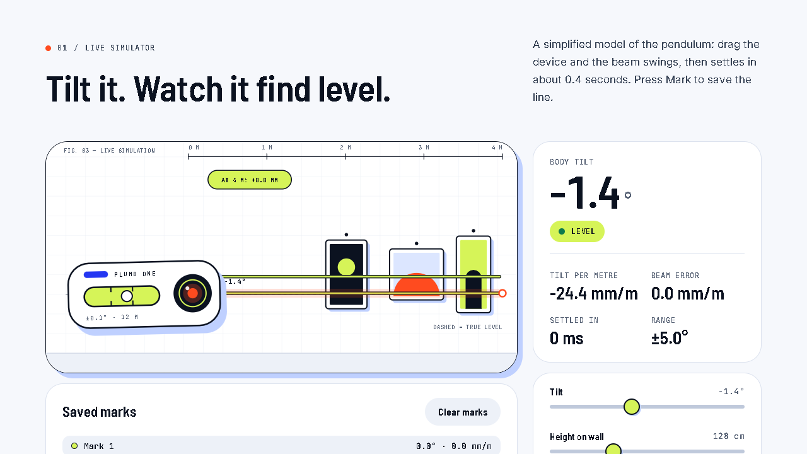

# Plumb — product site concept

**▶ [Open the live site](https://plumb.lbishop.app)**  ·  plumb.lbishop.app

1. Self-initiated concept: marketing site, product page and pricing for a fictional pocket laser level, "Plumb One". No real client, product or metrics.
2. Direction: light, airy and precise. Cool paper ground, hairline 12-column grid, hard-offset shadows, one hot accent (beam orange) and a lime "bubble".
3. Type: Bahnschrift for display, Segoe UI for body, Cascadia Mono for technical labels.
4. Custom SVG illustration throughout: hero scene, step diagrams, anatomy callouts, tolerance cone and a drift chart.
5. Deliverables in `pages/`: home, product, pricing (1440), home and pricing (390), plus a components and style sheet with hover, pressed, focus and form states.

## Live demo

**Plumb** is a fictional pocket laser level, built as a full multi-page product site with working tools. Nothing is for sale and nothing you type leaves your device.

- **Laser level simulator:** drag the device to tilt it, watch a damped pendulum settle in about 0.4 s, read live degrees and mm per metre, and **Mark** the line. Phone tilt works where the browser allows it.
- **Gallery wall planner:** set a centre line, drag frames, and get nail spacing in centimetres and inches, then copy the measurements.
- **Drift chart:** see how a small angle error grows with distance.
- **Product configurator, light and dark themes, reduced-motion support**, keyboard and screen-reader friendly.
- Nine pages (home, product, tools, how it works, pricing with a working pre-order form demo, FAQ, support, journal with two articles, 404). Self-hosted fonts, no external requests, no analytics.

[Open the live demo](https://plumb.lbishop.app)

© 2026 lbishopdev. All rights reserved. View only; see [LICENSE](LICENSE).
